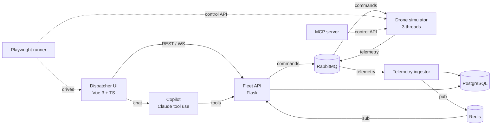

# Skyhaul

A drone delivery operations platform, built to show three things end to end:

- **Test automation infrastructure**: a layered test pyramid, a fault-injecting drone simulator, parallel isolated E2E runs with pytest + Playwright, and evidence on every failure.
- **AI from the first commit**: an MCP server for the simulator, a Claude-powered dispatcher copilot with evals, and an agent that triages failed tests.
- **A full-stack product**: Flask services, PostgreSQL, RabbitMQ, Redis, and a Vue 3 + TypeScript dispatcher UI with a live map.

> Status: **M0 · Foundations**. The architecture is designed; services arrive milestone by milestone.

## Architecture



## Quick start

Requirements: Docker, [uv](https://docs.astral.sh/uv/), Node 26, pnpm, gitleaks, pre-commit.

```sh
make setup   # dependencies and git hooks
make env     # .env with generated secrets
make up      # local stack on 127.0.0.1
make check   # lint, types, tests, secret scan
```

## Roadmap

| Milestone | Scope |
|---|---|
| M0 | Foundations: repo, tooling, CI, security guardrails, agent team |
| M1 | Message contracts and the drone simulator, with an MCP server |
| M2 | Fleet backend: Flask API, ingestor, PostgreSQL, Redis, realtime |
| M3 | Dispatcher UI |
| M4 | Automation infrastructure |
| M5 | AI copilot with evals |
| M6 | AI test intelligence: failure triage |
| M7 | Demo deploy and write-up |

## How it's built

Development uses a team of Claude Code subagents defined in [`.claude/agents/`](.claude/agents): product, architect, backend, frontend, automation, QA and security. Each owns one area of the repo. A human approves every issue and merges every PR. See [`CLAUDE.md`](CLAUDE.md) for the workflow and [`docs/adr/`](docs/adr) for design decisions.

## License

MIT
