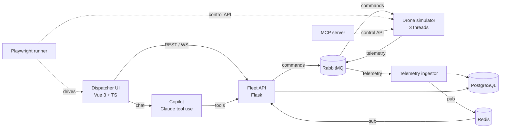

# Skyhaul

A drone delivery operations platform, built to show three things end to end:

- **Test automation infrastructure**: a layered test pyramid, a fault-injecting drone simulator, parallel isolated E2E runs with pytest + Playwright, and evidence on every failure.
- **AI from the first commit**: an MCP server for the simulator, a Claude-powered dispatcher copilot with evals, and an agent that triages failed tests.
- **A full-stack product**: Flask services, PostgreSQL, RabbitMQ, Redis, and a Vue 3 + TypeScript dispatcher UI with a live map.

> Status: **M0 · Foundations**. The architecture is designed; services arrive milestone by milestone.

## Architecture



## Quick start

Requirements: Docker, [uv](https://docs.astral.sh/uv/), Node 26, pnpm, gitleaks, pre-commit.

```sh
make setup   # dependencies and git hooks
make env     # .env with generated secrets
make up      # local stack on 127.0.0.1
make check   # lint, types, tests, secret scan
```

`make up` runs two one-shots before the API and the ingestor start: `migrate` (Alembic, as the schema owner `skyhaul_owner`) and `broker-init` (creates the broker users `skyhaul_api` and `skyhaul_ingestor` and declares the whole RabbitMQ topology). Every service then connects with its own least-privilege Postgres role and broker user (ADR 0013). The API serves REST on `127.0.0.1:8000/api/v1` and Socket.IO namespace `/fleet` on the same port; clients pass the access token as `auth: {token}`.

**Upgrading a stack from before M2 realtime (#29):** existing stacks need `make down -v` once, that is `docker compose down -v` (run it as `make down-volumes`: plain `make down -v` is make's own version flag). The Postgres roles come from an init script that runs only on a fresh volume, and `.env` needs the new keys (`DB_OWNER_PASSWORD`, `DB_API_PASSWORD`, `DB_INGESTOR_PASSWORD`, `AMQP_API_PASSWORD`, `AMQP_INGESTOR_PASSWORD`). Once:

```sh
make down-volumes     # docker compose down -v: drops the local database volume (works with an old .env)
rm .env && make env   # new secrets for every key; or add the new keys to .env with your own random values
make up
```

## Run the UI locally

```sh
make setup   # once: Python and web dependencies
make env     # once: .env with generated secrets
make up      # API, ingestor, Postgres, RabbitMQ, Redis
make sim     # drone simulator (test profile)
make seed    # 3 drones: registered, spawned in the simulator and sent on patrol missions (they fly circles)
cd web && cp .env.example .env.local && pnpm dev   # http://localhost:5173
```

`make seed` also starts the drones on patrol missions, so the markers move for several minutes. Run it again for another patrol. The dev server proxies `/api` and `/socket.io` to `SKYHAUL_API_URL` (default `http://127.0.0.1:8000`), so the API needs no CORS. A page reload means signing in again: the access token lives in memory only.

## Use the simulator from Claude Code

The repo's `.mcp.json` registers the `skyhaul-sim` MCP server (`services/mcp_sim/`, stdio). It holds only `${VAR}` references; the server reads its secrets from the environment Claude Code starts in, and never reads `.env`.

1. `make env` once, then `make sim` (RabbitMQ and the simulator with its control API on 127.0.0.1:8100). Add `SIM_DEBUG_TAP=1` to `.env` to also watch telemetry in the RabbitMQ management UI (queue `debug.telemetry`).
2. Start Claude Code in the repo with only the three variables the server needs:
   ```sh
   export $(grep -E '^(SIM_CONTROL_TOKEN|RABBITMQ_USER|RABBITMQ_PASSWORD)=' .env | xargs) && claude
   ```
   Don't source all of `.env` (or use a direnv `dotenv`): that would also export `ANTHROPIC_API_KEY`, which Claude Code itself may use instead of your own login. Optional: `SIM_CONTROL_URL`, `RABBITMQ_HOST`, `RABBITMQ_PORT` (defaults `http://127.0.0.1:8100`, `127.0.0.1`, `5672`).
3. Approve the project server, and check `/mcp` lists `skyhaul-sim`. Without the variables the server still starts, and every tool answers "not configured: set ...".
4. Try: *"Spawn 5 drones in dev. ARM dev-d001, take it off to 20 m, send it with GOTO to 32.001, 34.8 at 20 m, then read its POSITION telemetry for 10 seconds."*

Tools: `spawn_drones`, `list_drones`, `get_drone`, `inject_fault`, `clear_faults`, `reset_namespace` (control API), and `send_command`, `read_telemetry` (RabbitMQ, through the Codec, like a ground station). See ADR 0007.

## Roadmap

| Milestone | Scope |
|---|---|
| M0 | Foundations: repo, tooling, CI, security guardrails, agent team |
| M1 | Message contracts and the drone simulator, with an MCP server |
| M2 | Fleet backend: Flask API, ingestor, PostgreSQL, Redis, realtime |
| M3 | Dispatcher UI |
| M4 | Automation infrastructure |
| M5 | AI copilot with evals |
| M6 | AI test intelligence: failure triage |
| M7 | Demo deploy and write-up |

## How it's built

Development uses a team of Claude Code subagents defined in [`.claude/agents/`](.claude/agents): product, architect, backend, frontend, automation, QA and security. Each owns one area of the repo. A human approves every issue and merges every PR. See [`CLAUDE.md`](CLAUDE.md) for the workflow and [`docs/adr/`](docs/adr) for design decisions.

## License

MIT
